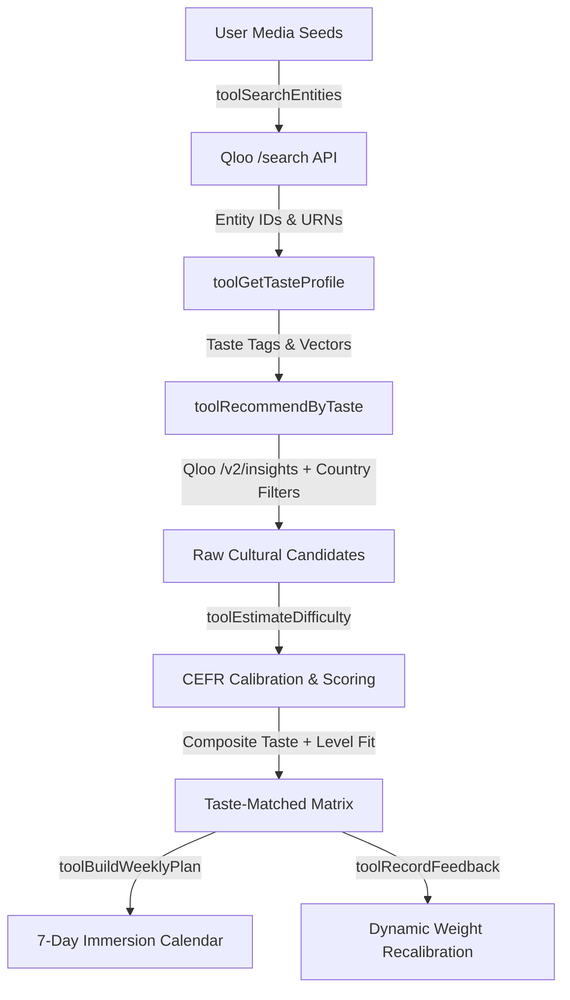

# 🌍 LinguaTaste — Taste-Matched Language Immersion

> **Qloo LLM / Agentic Hackathon Project**  
> *Transforming language learning dropout into lifelong passion through cultural grounding via Qloo's Cultural Taste Graph.*

---

## 🎯 The Core Problem & The Qloo Insight
Most people quit language learning because beginner materials are excruciatingly boring: artificial textbook dialogues, nursery rhymes, or clichéd mainstream pop tracks.

**Why Generic LLMs Fail**: When asked to recommend immersion content, generic LLMs fall back on predictable, mainstream clichés:
- Recommending *"Despacito"* to every Spanish learner.
- Recommending *"Doraemon"* to every adult Japanese learner.
- Recommending *"Emily in Paris"* (an English-language show!) to French learners.

**Why LinguaTaste ONLY Works With Qloo**:
Qloo's Taste Graph maps a learner's existing media passions (favorite bands, directors, anime, podcasts, authors) directly into target-language media sharing the **exact same cultural DNA**, while simultaneously calibrating each recommendation to the learner's **CEFR language proficiency level (A1–C2)**.

- **Radiohead + Death Note fan (learning Japanese A1)** $\rightarrow$ Discovers Japanese math-rock band **toe** and psychological cyberpunk anime **Serial Experiments Lain** (both matching the user's introspective, complex aesthetic, with sparse, intelligible language).
- **Kendrick Lamar + Serial true-crime fan (learning Spanish A2)** $\rightarrow$ Discovers conscious Venezuelan rapper **Canserbero** and Spanish true-crime drama **El cuerpo en llamas**.
- **Amélie + Camus philosophy reader (learning French B1)** $\rightarrow$ Discovers Nouvelle Vague cinema **Cléo from 5 to 7** and art-rock group **Feu! Chatterton**.

---

## 🏗️ Architecture & Agentic Tool Chain

LinguaTaste implements an end-to-end agentic pipeline orchestrating live Qloo API endpoints and pedagogical linguistic calibration:



### 1. `search_entities` (`GET /search`)
Resolves free-text user inputs to canonical Qloo entity IDs across URN domains:
- `urn:entity:artist`
- `urn:entity:movie`
- `urn:entity:tv_show`
- `urn:entity:book`
- `urn:entity:podcast`

### 2. `get_taste_profile` (`GET /v2/insights`)
Extracts multi-dimensional taste signals, generating top cultural tags and affinity distributions.

### 3. `recommend_by_taste` (`GET /v2/insights`)
Queries cross-domain recommendations filtered to target languages and countries (`filter.release_country=JP,ES,FR,KR...`) with explainability enabled (`feature.explainability=true`).

### 4. `estimate_difficulty`
Scores candidate difficulty from 1–10 and calculates a Gaussian pedagogical sweet-spot distance against the user's CEFR level:
$$\text{Composite Score} = 0.6 \times \text{Qloo Affinity} + 0.4 \times \text{Difficulty Fit}$$

### 5. `build_weekly_plan`
Generates a complete 7-day immersion calendar matching the learner's weekly study budget, complete with pre-teach vocabulary (words, translations, pronunciations) and active challenge tasks.

### 6. `record_feedback`
Processes learner feedback (thumbs up/down, "Too Hard", "Too Easy", "Just Right") to dynamically recalibrate affinity weights and difficulty thresholds.

---

## ⚡ Quickstart

### 1. Clone & Install Dependencies
```bash
git clone <repository-url>
cd qloo_test
npm install
```

### 2. Configure Environment Variables
Copy `.env.example` to `.env.local`:
```bash
cp .env.example .env.local
```

| Variable | Required / Optional | Purpose |
| :--- | :--- | :--- |
| `QLOO_API_KEY` | **Required** (or uses mock demo data) | Qloo V2 Cultural Taste Graph & Search API |
| `ANTHROPIC_API_KEY` | Optional | Claude 3.5 Sonnet linguistic difficulty scoring |
| `TMDB_API_READ_ACCESS_TOKEN` | **Recommended** | Film/TV poster images (`w342`, `w780`) and JustWatch watch providers |
| `WATCHMODE_API_KEY` | Optional | Upgrades film/TV links to Tier 1 direct platform deep links |
| `SPOTIFY_CLIENT_ID` / `_SECRET` | Optional | Upgrades music links to Tier 1 Spotify track/artist deep links |

> **Note for Judges**: If you run LinguaTaste without configuring keys or offline, the app includes high-fidelity simulated taste-graph fallback data, SVG placeholder artwork, and universal platform search links for all demo personas, so every flow is immediately interactive and testable!

### 3. Run Development Server or Tests
```bash
# Run unit tests (artwork title matching & link tier logic)
npm test

# Run development server
npm run dev
```
Open [http://localhost:3000](http://localhost:3000) in your browser.

---

## 🖼️ Media Artwork & "Where to Consume" Availability Architecture

LinguaTaste provides rich cover artwork and verified, region-specific "Where to Watch / Read / Listen" streaming and purchase links for every single recommendation.

### API & Link Tier Matrix

| Media Type | Artwork Primary Source | Artwork Fallback Sources | Streaming & Availability Source | Link Tier Provided |
| :--- | :--- | :--- | :--- | :--- |
| **Film / TV** | Qloo Entity Image | TMDB API (`/3/search/movie`, `/3/search/tv`, `w342`/`w780`) | TMDB `/watch/providers` (powered by JustWatch) + optional Watchmode API | **Tier 1**: Direct media deep link (via Watchmode)<br>**Tier 2**: JustWatch provider page (via TMDB) |
| **Books** | Open Library Covers (`/b/isbn/{ISBN}-L.jpg`, `/b/olid/{OLID}-L.jpg`) | Google Books API thumbnail | Open Library preview, Google Books, Kindle, Bookshop.org, Libby | **Tier 2**: Open Library / Google Books reading link<br>**Tier 3**: Kindle, Bookshop.org & Libby search links |
| **Music** | iTunes Search API (`600x600` artwork) | Deezer Search API (`picture_xl`) | Spotify API, Apple Music, YouTube Music, Deezer | **Tier 1**: Direct Spotify/Deezer artist/album link<br>**Tier 3**: Platform pre-filled search URL |
| **Universal Fallback** | Dynamic SVG gradient card | Never displays a broken image | YouTube trailer search & Google Web search | **Tier 3**: Direct title query fallback |

### Link Resolution Hierarchy
- **Tier 1**: Direct deep link to the exact title on the streaming service (e.g., `https://netflix.com/title/123` or Spotify artist URI).
- **Tier 2**: Provider-level aggregator link from JustWatch / TMDB or Open Library reading view.
- **Tier 3**: Pre-filled search URL on the platform (labelled `"Search on [Platform]"`).

### Availability Filtering & Subscription Ranking Boost
- **Region Selector**: Set your country (e.g. 🇺🇸 US, 🇬🇧 GB, 🇯🇵 JP, 🇪🇸 ES, 🇫🇷 FR, etc.) to fetch geo-restricted streaming availability.
- **Subscription Platforms**: Select active services (Netflix, Prime Video, Disney+, Hulu, Max, Apple TV+, Spotify, Apple Music, YouTube Premium).
- **Ranking Boost**: Items available on your active subscriptions receive a **+15% composite ranking boost** to prioritize content you can immediately consume.
- **"Available to Me" Filter**: One-click toggle hides all items not accessible on your active platforms.

---

## 🎮 Key Demo Features for Judges

1. **Judge Quick-Launch Personas**:
   - 🎸 *The Anime & Indie Rock Fan* (Japanese A1)
   - 🎤 *The True Crime & Hip-Hop Fan* (Spanish A2)
   - 🌸 *The K-Drama Newcomer* (Korean A1)
   - 🗼 *The French Cinema Lover* (French B1)
2. **Posters, Covers & "Where to Consume"**:
   - High-resolution posters with fixed aspect ratios (`2:3` for movies/shows/books, `1:1` for music) to prevent cumulative layout shift (CLS).
   - Official platform icons (Netflix, Prime Video, Disney+, Spotify, Apple Music, Kindle, Libby) with direct deep links opening in a new tab.
3. **Structured 7-Day Immersion Calendar**:
   - Day-by-day study sessions showing the poster and exact platform link: *"Tue: Episode 1 on Netflix [icon, link]"*, pre-teach vocabulary, and active challenges.
4. **Qloo vs. Generic LLM Side-by-Side Tab**:
   - Direct benchmark comparison showing why generic LLMs produce cliché recommendations while Qloo discovers authentic cultural peers.
5. **Interactive Feedback Loop**:
   - Rate any recommendation with Thumbs Up/Down or "Too Hard"/"Too Easy" to watch the agent adapt.
6. **Live Agent Execution Console**:
   - Click the **Log** button in the header to view live tool execution steps.

---

## ⚖️ Compliance & Attributions
- **TMDB Attribution**: This product uses the TMDB API but is not endorsed or certified by TMDB.
- **JustWatch Attribution**: Streaming availability data provided by JustWatch.
- **Rate Limits & Hotlinking**: All artwork and provider queries are cached in-memory with TTL and adhere to each third-party provider's terms of service.
